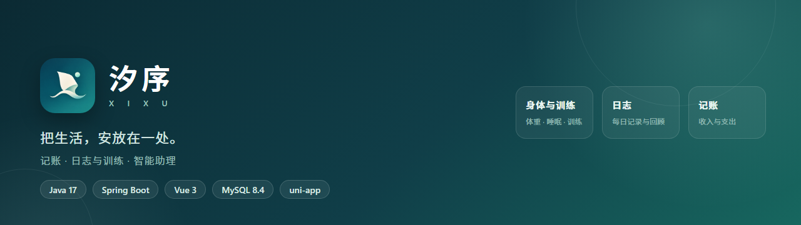

<p align="center">
  
</p>

<p align="center">
  
  
  
  
  
</p>

# 汐序 · 个人生活数据管理系统（毕业设计）

2027 届本科毕业设计工作区。当前阶段：**两端并行开发**；Android 登录已在真机验证，Vue 3 Web 端使用同一账号进入工作台也已验证。记账服务端接口与“手机新增 → Web 查看 → Web 作废”跨端流程已联调通过。

## 下次在本机启动

1. MySQL 的 `MySQL84` 服务通常随 Windows 自动启动。可用 `Get-Service MySQL84` 检查；若状态是 `Stopped`，在**管理员 PowerShell** 中运行 `Start-Service MySQL84`。
2. 打开第一个 PowerShell 终端，启动后端并保持窗口运行：

   ```powershell
   cd E:\graduation-project\server
   .\start-local.ps1
   ```

   按提示在本机输入 MySQL 用户名和密码。已有管理员账号，**不要加 `-CreateAdmin`**。看到 `Started XixuServerApplication` 即表示后端已启动（端口 18080）。
3. 打开第二个 PowerShell 终端，启动 Web：

   ```powershell
   cd E:\graduation-project\admin
   npm run dev
   ```

   浏览器打开 <http://127.0.0.1:5173/>。用完后，分别在两个终端按 `Ctrl+C` 停止；MySQL 服务可保持运行。手机 USB 调试需要额外设置，见[本地运行说明](docs/登录功能本地运行.md)。

## 项目边界

- 核心业务：记账、课表与日程、每日日志及健身训练、附件归档。
- 交付形态：Android 客户端、可部署到云服务器的 Web 管理端、统一服务端与数据库；两端共用同一套业务数据。
- Android 端暂定 uni-app（Vue 3）；若指导教师要求原生开发，再调整为 Kotlin。Web 使用 Vue 3，服务端使用 Spring Boot，数据存入 MySQL。
- 智能助理拟通过受控工具生成记录草稿、查询跨模块统计；写入由用户确认。图片文字识别视进度增加。微信和 DeepSeek Harness 只作为现有原型的需求来源，不是新系统运行的前提。
- 数据库按业务关系和 ER 图设计；原先 10～12 张表的估计已随着范围调整而失效。

## 目录

| 目录 | 用途 | 当前状态 |
|---|---|---|
| `docs/` | 选题、需求、开发环境、接口说明 | 选题意向、运行说明、记账接口与模块审查 |
| `design/` | 流程图、原型、架构图、ER 图 | 登录页、首页、架构与[应用图标](design/汐序图标说明.md)已保存 |
| `database/` | 数据字典、ER 图对应的 SQL、迁移脚本 | `app_user` 与 `ledger_entry` 已由用户建表；日志表已迁移并据用户报告导入 184 条样本，见 [数据库说明](database/README.md) |
| `server/` | Spring Boot API | 登录与记账已通过真实接口联调；日志代码通过单元测试，样本已由用户导入并在 Web 回看，手动新增仍待联调，见 [日志接口说明](docs/日志与训练接口说明.md) |
| `admin/` | Vue 3 Web 管理端 | 登录、记账已验证；日志样本已由用户在页面确认可见，手动保存仍待验证；见 [运行说明](admin/README.md) |
| `android/` | uni-app Android 客户端 | 真机登录与记账已由用户验证；日志与训练的录入、按月回看页面已运行到手机并确认可打开，新增保存尚待真实数据联调 |
| `deploy/` | 云端部署说明与必要配置 | 本机闭环后再部署 |
| `thesis/` | 论文与答辩材料 | 待撰写 |

## 近期顺序

1. 与指导教师确认选题范围及 uni-app 是否符合 Android 端要求。
2. 确定核心用例和数据库实体、关系，再写 ER 图与建表 SQL。
3. 做通一条端到端流程：手机记账 → 服务端入库 → Web 查询与更正。（2026-10-31 已验证）
4. 完成日志与训练的建表联调，再逐步加入课表、附件、提醒及智能助理。

旧版高范围方案保存在 `docs/选题意向-初稿-2026-10-30.md`，用于保留修改来由；当前方案以 `docs/选题意向.md` 为准。学校时间表 PDF 保留在根目录。

参与与致谢见 [CONTRIBUTORS.md](CONTRIBUTORS.md)。