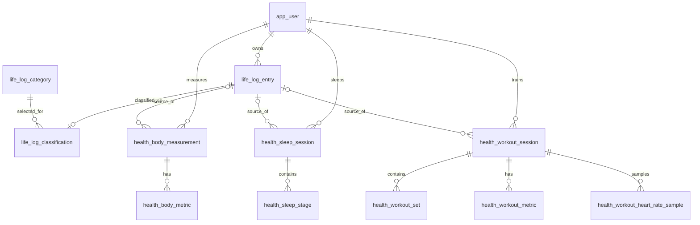

# 身体健康与日志分类设计（第一版）

## 模块边界

汐序的一级模块改为 **身体与训练、日志、记账**。身体与训练优先展示体重与体成分、睡眠、训练；日志保留一天中的叙述、感受和原始导入行；记账只管理真实收支。日程与附件以后仍可独立加入。首页按这三个模块组织，不用“账本”代表整个产品。

`life_log_entry` 继续作为原始记录档案，不删除、不覆盖 `category_name`、`content`、`remark`、`source_ref`。结构化健康记录可以通过 `source_log_id` 指回原文。**分类不等于事实提取**：一条“运动”原文只能先归入身体模块，不能据此自动生成一次已完成训练；睡眠时长、体脂率等未明确给出的数值也不补造。

本地导入脚本当前解析出 10 天、184 行：睡眠 36、饮食 33、运动 20、身体 8、体征 4、补剂 13、饮水 1、精力 1；其余为日程 43、消费 12，以及情绪、心得、学习、娱乐、习惯、环境等。它们是本地文件类别计数，不代表已清洗或已验证的健康数据。

## 新表

| 表 | 用途 | 最重要的字段 |
|---|---|---|
| `life_log_category` | 受控主题字典，区分 `HEALTH`、`JOURNAL`、`LEDGER`、`SCHEDULE`、`OTHER` | `code`, `domain_code`, `name` |
| `life_log_classification` | 一条原始记录当前的主主题和审核状态 | `log_entry_id`, `category_id`, `method`, `review_status` |
| `health_body_measurement` | 一次体重或体成分测量；时间不详时只填日期 | `observed_on`, `observed_at_utc`, `weight_kg`, `body_fat_pct`, `muscle_mass_kg` |
| `health_body_metric` | 设备额外指标，如骨骼肌量、水分率、内脏脂肪等级 | `measurement_id`, `metric_code`, `value_decimal`, `unit_code` |
| `health_sleep_session` | 一段夜间睡眠或午睡，保存总量和设备汇总 | `sleep_on`, `duration_minutes`, `deep_minutes`, `rem_minutes`, `efficiency_pct` |
| `health_sleep_stage` | 有真实时间线时才存睡眠阶段片段，供睡眠结构图使用 | `session_id`, `stage_code`, `started_at_utc`, `ended_at_utc` |
| `health_workout_session` | 一次训练的日期、类型、时长、能量和心率汇总 | `occurred_on`, `activity_name`, `duration_seconds`, `active_kcal`, `avg_heart_rate_bpm` |
| `health_workout_set` | 训练动作的组次、次数、重量和时长 | `session_id`, `sequence_no`, `exercise_name`, `repetitions` |
| `health_workout_metric` | **可选附加指标**：设备给出的心率区间时长、恢复指标、有氧/无氧效果等 | `session_id`, `metric_code`, `value_decimal`, `unit_code` |
| `health_workout_heart_rate_sample` | **可选明细**：设备确实提供逐点心率时，才绘制曲线 | `session_id`, `offset_seconds`, `heart_rate_bpm` |

目前的 `workout_set` 仍关联 `life_log_entry`。新表 `health_workout_set` 是后续身体模块的目标结构；本 SQL **不迁移或删除旧训练记录**。等服务端和页面改为新接口，再用可核对的迁移脚本转换手动训练，保留 `source_log_id`。旧数据无需立刻搬动。

## 关键关系

## 口径与页面

- `observed_on` / `sleep_on` / `occurred_on` 是用户所处日期，用于日历和按月查询；精确时刻使用 UTC，未知则为 `NULL`。睡眠归属日期按**醒来日期**，午睡同理。
- 体重、体脂、肌肉量等实际测量值入库；BMI 可根据当次身高和体重计算。设备给出的 BMI、身体年龄、评分、排名等只能作为带来源的设备指标，不能替代测量值或当医学结论。
- 设备没有提供睡眠阶段片段或逐点心率时，只存时长、平均/最高心率等汇总；不绘制伪造的曲线。
- 心率区间时长、恢复指标与训练效果属于设备口径，记录原始代码、值和单位；不同厂商的评分不直接横向比较。
- 服务端还需校验同一睡眠的阶段片段不重叠、落在入睡与醒来时间之间；训练心率采样偏移不得超过已知训练时长。跨行规则不能只靠本版 `CHECK` 约束完成。
- 原始类别映射到受控主题后先标为 `PENDING`。用户确认后改为 `CONFIRMED`。未知类别进 `OTHER_UNSORTED`，不猜测。
- 第一版每条原文只有一个**主主题**，足以整理当前按单一类别填写的 184 行；若以后出现一条记录同时涉及睡眠和训练，再增加多标签关联表，不把多个主题塞进逗号分隔字符串。
- 所有健康接口按登录用户 `user_id` 隔离；服务端在写入 `source_log_id` 时还必须核对原日志属于同一用户。管理员角色不应默认拥有查看其他人健康详情的权限。
- 日志页默认保留**全部原始记录**，提供身体、日常、日程、消费等主题筛选，避免原有 184 行突然“消失”；身体页另外展示结构化数据与 `HEALTH` 类待整理原文；记账页仍只统计 `ledger_entry`，原始“消费”文字不自动变成账目。

## 实施顺序

1. 在备份后，执行 [08 建表与原始类别映射 SQL](08-身体健康与日志分类建表.sql)。它只新建表、写入受控类别和初始分类，不改写现有 184 条原文或旧训练组次。
2. 服务端增加只读“身体概览”与“原始记录分类”接口，Web 和手机首页改为身体、日志、记账三个入口。此时空的健康指标明确显示“尚未记录”。
3. 先完成体重/体成分和睡眠的手动录入与趋势，再将训练录入切到 `health_workout_session` / `health_workout_set`。迁移旧手动训练前核对条数和外键。
4. 最后接入设备数据导入、睡眠阶段、心率曲线；只处理实际能导出的数据格式，不把截图里的曲线反推成精确采样点。

本设计与建表脚本是**待导入草案**，截至编写时未在 `xixu_dev` 执行，也未修改现有 API。
