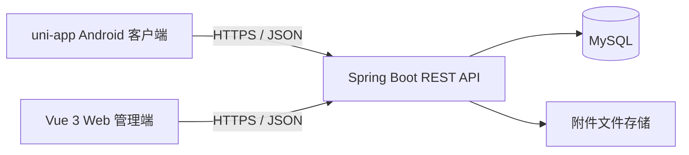

# 汐序 · 系统架构草案

状态：2026-10-31 目标架构，**尚未部署**。用户确认最终要有可部署到云服务器的 Web 管理系统，并与 uni-app Android 客户端管理同一份数据。

本地进度：Android 与 Web 已分别用同一账号接入 Spring Boot 登录接口；Web 开发服务器通过 `/api` 代理访问本机后端。业务数据同步将在记账等模块接入后验证。

## 两端的分工

- 手机端：随时录入和查看记账、日程、日志、附件。
- Web 端：更方便地查询、编辑、筛选、统计与整理同一用户的数据，也提供必要的账号管理页面。
- 服务端：统一执行身份认证、数据归属与权限检查、业务规则、附件上传和读取。
- 数据库与附件存储：由服务端访问。手机与浏览器不直接连接 MySQL。

“Web 管理端”是使用方式，**不等于登录者必须是 ADMIN**。普通用户登录 Web 后可管理自己的生活数据；ADMIN 首期只管理账号状态，不默认查看他人的私人内容。具体权限以接口设计和服务端实现为准。

## 开发与部署顺序

1. 本机先做通：手机录入一笔账 → Spring Boot 写入 MySQL → Web 查询与更正 → 手机再次看到更正结果。
2. 再扩展课表、日志、附件，并补充测试与备份方式。
3. 最后把 Web 静态资源、Spring Boot 服务和数据库部署到云服务器，配置 HTTPS 与访问控制。MySQL 只供服务端访问，不开放给公网客户端。

具体云服务、域名、附件存储方案和部署方式，等本机闭环跑通后再定；已有的 `yuhang.wiki` 不在此阶段改 DNS。
